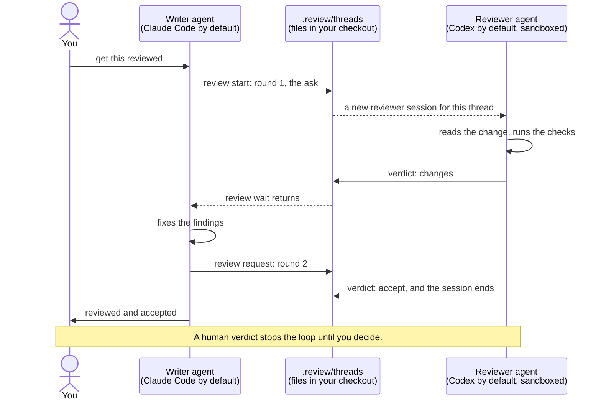

<p align="center">
  
</p>

<h1 align="center">rounds</h1>

<p align="center"><b>Personal code reviews between two coding agents, on your machine.</b></p>

One agent writes, another reviews, round after round, until the reviewer accepts or asks you to
decide. The reviewer runs in a sandbox: it reads your code and runs your checks, but it cannot
change a file of your project.

**It is for you, not for your team.** Nothing is committed, nothing is pushed, nothing reaches a
pull request: the reviews live in `.review/` of your checkout, which git ignores. Use it as a
second opinion before you share your work.

## How it works



Each review thread gets its own reviewer session. The two agents talk only through plain files,
so every review is a record you can read: what was asked, what was found, what was fixed.

## Install

Tell your agent, from inside your project:

> Set up rounds in this project: https://github.com/oscillatingworks/rounds

Or by hand:

```sh
curl -fsSL https://raw.githubusercontent.com/oscillatingworks/rounds/main/install.sh | sh
```

## Use

Ask your agent for a review when a change is ready: "get this reviewed". It opens a thread, a
reviewer starts beside it (a tab in Herdr, a window in tmux, or a background process), and your
agent answers the findings until the reviewer accepts. The first time, Codex asks in its tab
whether to trust your project: answer it there, once. `.review/bin/review status` lists the
threads, newest first; `review open <thread>` prints where a thread's files are (git ignores
`.review`, so editors hide it).

Any agent and any model can take either role. Claude Code writes and Codex reviews by default;
`reviewer` in `.review/config.json` changes the reviewer.

## Remove

```sh
.review/bin/review uninstall           # keeps the threads
.review/bin/review uninstall --purge   # removes them too
```

## More

[AGENTS.md](AGENTS.md) has the details: requirements, agents and models, the sandbox, where the
reviewer runs, and how to work on rounds. [docs/method.md](docs/method.md) says why the method
works this way.

## License

MIT. See [LICENSE](LICENSE).
