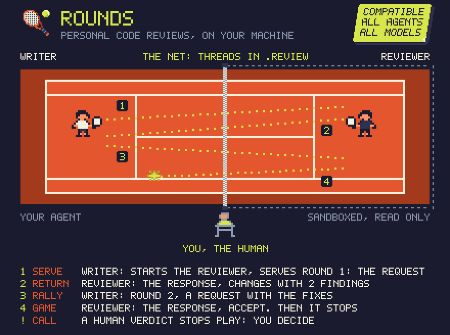

<p align="center">
  
</p>

<h1 align="center">rounds</h1>

<p align="center"><b>Personal code reviews between two coding agents, on your machine.</b></p>

One agent writes, another reviews, round after round, until the reviewer accepts or asks you to
decide. The reviewer runs in a sandbox: it reads your code and runs your checks, but it cannot
change a file of your project.

**It is for you, not for your team.** Nothing is committed, nothing is pushed, nothing reaches a
pull request: the reviews live in `.review/` of your checkout, which git ignores. Use it as a
second opinion before you share your work. The one exception is a review you post yourself (below).

## How it works

<p align="center">
  
</p>

Your agent (Claude Code by default) starts a reviewer (Codex by default) for the review and serves
round 1: the request. The reviewer reads the change, runs your checks, and returns a response with
a verdict. The rally goes on until the reviewer accepts, and then the reviewer stops. When a
decision is yours, play stops until you make it.

Each review thread is one match, with its own reviewer session. The two agents talk only through
plain files, so every review is a record you can read: what was asked, what was found, what was
fixed.

## Install

Tell your agent, from inside your project:

> Set up rounds in this project: https://github.com/oscillatingworks/rounds

Or by hand:

```sh
curl -fsSL https://raw.githubusercontent.com/oscillatingworks/rounds/main/install.sh | sh
```

## Use

Ask your agent for a review when a change is ready: "get this reviewed". It opens a thread, a
reviewer starts beside it (a tab in Herdr, a window in tmux, or a background process), and your
agent answers the findings until the reviewer accepts. The first time, Codex asks in its tab
whether to trust your project: answer it there, once. `.review/bin/review status` lists the
threads, newest first; `review open <thread>` prints where a thread's files are (git ignores
`.review`, so editors hide it).

Any agent and any model can take either role. Claude Code writes and Codex reviews by default;
`reviewer` in `.review/config.json` changes the reviewer.

## Independent, not adversarial

By default the reviewer is independent, not adversarial. It is another agent, in its own session,
that sees only your request and the code, runs the real checks, and cannot change a file. But it
reviews with an open mind: it looks for what is wrong, says what it checked and found fine, and
accepts when nothing blocking remains. That keeps the loop short for everyday changes.

For a risky change, ask for a skeptic. The reviewer then assumes the change is wrong, tries to break
every claim, and gives each finding a concrete failure:

```sh
.review/bin/review start <thread> --stance adversarial < ask.md   # one thread
```

Or tell your agent "get an adversarial review". To make every thread adversarial, set
`"stance": "adversarial"` in `.review/config.json`.

## Review a pull request

Tell your agent "review PR 42". You read the comment first; it is posted only when you say so,
from your account, signed "reviewed by 🎾rounds".

## Remove

```sh
.review/bin/review uninstall           # keeps the threads
.review/bin/review uninstall --purge   # removes them too
```

## More

[AGENTS.md](AGENTS.md) has the details: requirements, agents and models, the sandbox, where the
reviewer runs, and how to work on rounds. [docs/method.md](docs/method.md) says why the method
works this way.

## License

MIT. See [LICENSE](LICENSE).
